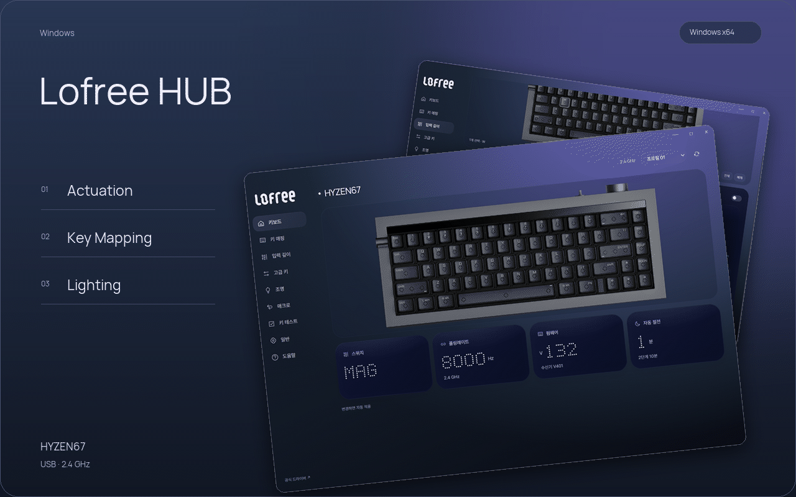

[Windows](#requirements-and-setup) · [User guide](docs/user-guide.md)

  

**1.1.2 · Windows 10 / 11 · x64**

[Release notes](https://github.com/iismn/PR-LofreeHyzenHub/releases/tag/v1.1.2) · [User guide (Korean)](docs/user-guide.md) · [Issues](https://github.com/iismn/PR-LofreeHyzenHub/issues)

[Actuation](#actuation) · [Key Mapping](#key-mapping) · [Lighting](#lighting)

 

## Actuation

Actuation depth, separate press/release Rapid Trigger, and top/bottom deadzones in **MAG** mode.

The indicator stays fixed while the scale moves. Drag, scroll, or use the arrow keys. Ticks settle into place; hovering a block lights its tick marks and dot readout.

 

## Key Mapping

Seven profiles. Basic, media, mouse, lighting and macro bindings. Four shared Fn layers for Windows and macOS.

Select a key, then choose its action. Hold **Ctrl** to select multiple keys, or use **WASD** / **All**. Advanced keys include **MT, TGL, DKS, RS, SOCD and HT**. Record macros in 28 slots and assign them from Key Mapping.

 

## Lighting

Backlight, front light bar and receiver effects, with brightness, color, speed and direction where supported.

Changes apply automatically. Continuous adjustments are coalesced and sent in order; the final value is read back from the keyboard. The footer shows progress and provides **Retry** after a failed transfer.

 

## Connection

Click **Connect** to read the keyboard settings and enter the app. USB and 2.4 GHz are supported. After connecting, the app detects transport changes and prefers USB when available.

USB-only controls appear when connected by cable. Calibration also requires **MAG** mode. The UI is dark-only, with an English Lofree logo and **MAG / MEC** mode readouts.

 

<strong>Requirements and setup</strong>

Windows 10 or Windows 11, x64, .NET Framework 4.8, and Microsoft Edge WebView2 Runtime.

1. [Download LofreeHUB.exe](https://github.com/iismn/PR-LofreeHyzenHub/releases/download/v1.1.2/LofreeHUB.exe) to a writable folder and run it.
2. Connect the keyboard by USB or its 2.4 GHz receiver, then click **연결**.
3. Select a key or setting. Changes apply automatically; a separate save button is not required.

If the app reports that WebView2 is missing, [install the WebView2 Runtime](https://developer.microsoft.com/microsoft-edge/webview2/).

For a stable Start menu shortcut, download the [Windows ZIP](https://github.com/iismn/PR-LofreeHyzenHub/releases/download/v1.1.2/LofreeHUB-1.1.2-Windows-x64.zip), extract it, and run `Install.ps1` with PowerShell. It installs to `%LOCALAPPDATA%\Programs\LofreeHUB` and registers **Lofree HUB** in Start. Right-click the app in Start to pin it.

Settings change on the keyboard. WebView2 data stays in `%LOCALAPPDATA%\HyzenControl`, preserving the earlier app's local data. Close the app before replacing its EXE. The interface currently uses Korean labels.

<strong>Limitations and validation</strong>

- Bluetooth configuration is not supported.
- Calibration, firmware updates and factory reset open the [official Hyzen driver](https://hyzen.lofree.tech/#/). These operations are not implemented inside this app.
- JSON backup covers the current profile's basic mapping and function settings; Fn layers, actuation tables, advanced parameters and macro bodies are outside that backup format.
- Key testing and macro recording use input delivered to the focused app. Fn and system-intercepted shortcuts may not appear. Recorded intervals do not measure hardware latency or polling rate.
- Actual hardware validation used a HYZEN67 2.4 GHz receiver. USB visibility and transport decisions were tested with fixtures; physical USB switching and every advanced hardware write have not been tested.
- The preview uses real app screenshots arranged in a loop. Release screenshots were captured with device writes blocked. See the [validation notes](docs/validation.md) for the exact scope.

 

---

[Download 1.1.2](https://github.com/iismn/PR-LofreeHyzenHub/releases/download/v1.1.2/LofreeHUB.exe) · [User guide (Korean)](docs/user-guide.md) · [Build guide (Korean)](docs/technical-guide.md) · [Report an issue](https://github.com/iismn/PR-LofreeHyzenHub/issues)

[Asset sources](REFERENCE.md) · [Fonts and WebView2 notices](licenses) · [Preview source](docs/tools/README.md)
