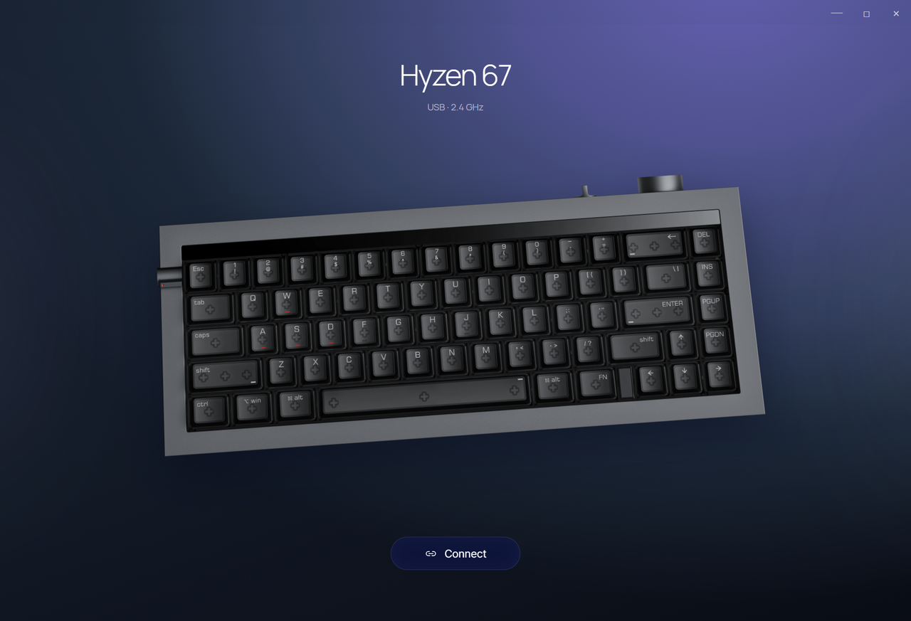
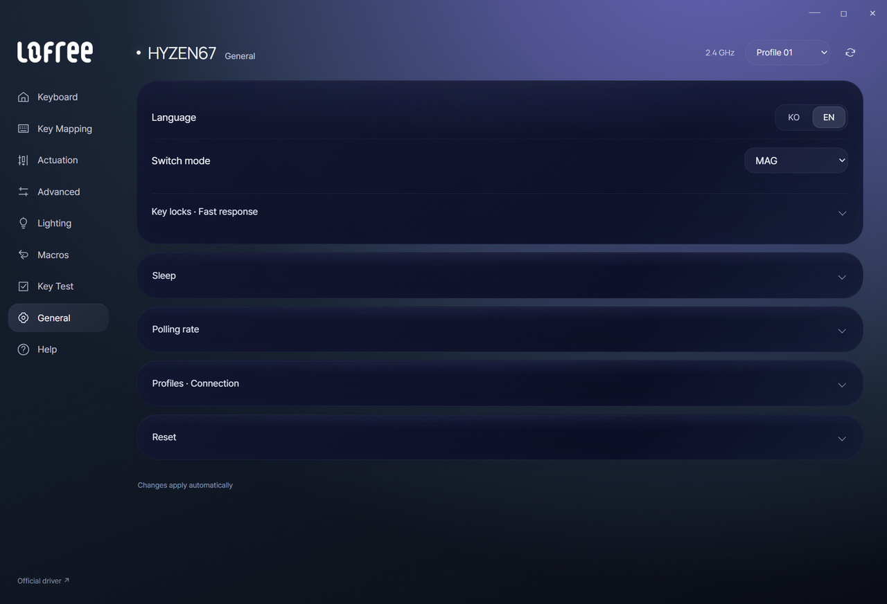
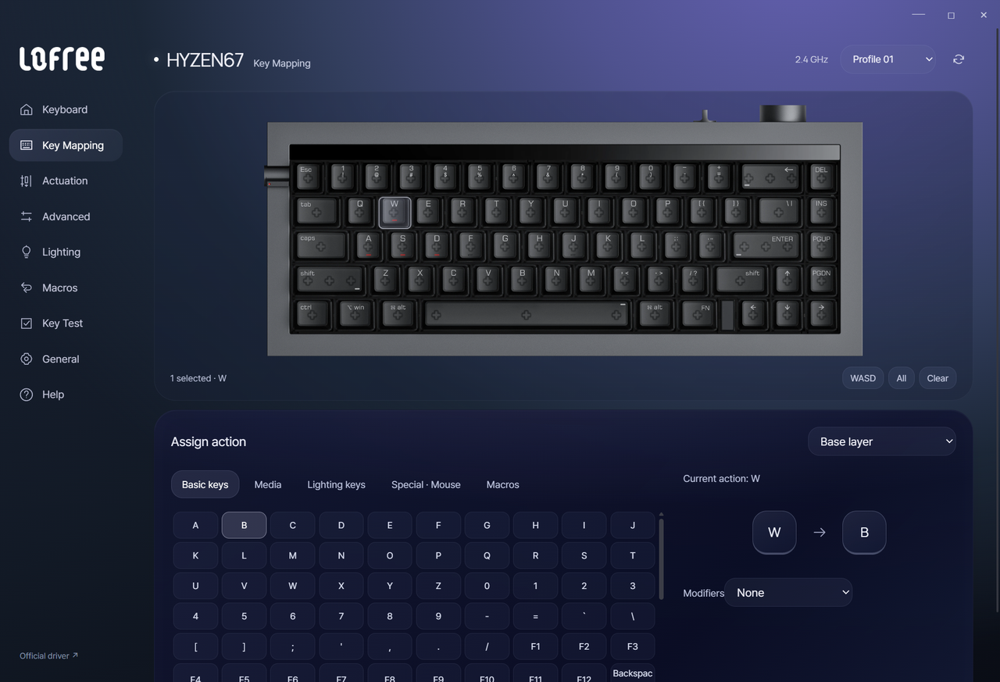
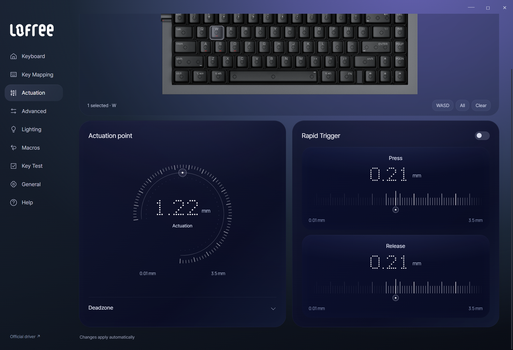
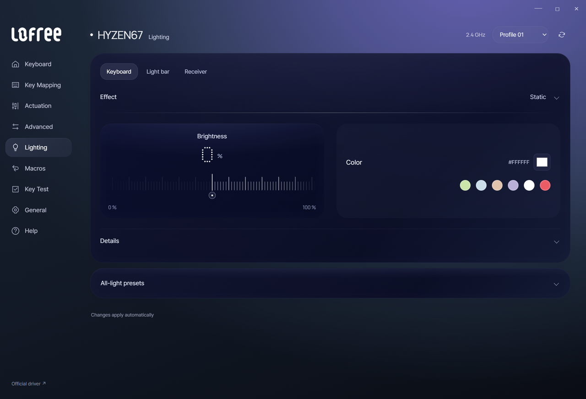

# Lofree HUB user guide

## Run and connect

Download `LofreeHUB.exe` from [Releases](https://github.com/iismn/PR-LofreeHyzenHub/releases). Windows 10/11 x64, .NET Framework 4.8 and Microsoft Edge WebView2 Runtime are required. No administrator privileges or separate HID driver are needed.

Connect the keyboard by USB or its 2.4 GHz receiver, then click **Connect**. On the first launch the label is **연결**. The app reads the stored keyboard settings and opens the control screen. After connecting, it detects transport changes and prefers USB when available.

## Choose a language

Open **General → Language** and select **KO** or **EN**. With Korean selected, the path is **일반 → 언어**. Menus, key lists, help, status messages and app errors change together. The selection is kept after restarting.

Language is a local app preference. Switching it does not send keyboard settings or force pending edits to apply. Current field values and expanded sections are preserved.

## Automatic apply

Change a setting to apply it without a save button. Continuous edits are coalesced and sent in order; the final value is read back for verification. Pending edits are processed before changing keys, layers, profiles or pages, and before closing the app.

The footer shows pending, applying, applied or error status. Select **Retry** after a failed transfer. Refresh discards queued changes and reloads the current keyboard values. Empty or out-of-range numeric inputs are not sent.

Do not connect the official driver at the same time. If the keyboard does not respond, wake it, close other controllers and reconnect.

## Mapping and profiles

Select one of seven profiles at the top. In **Key Mapping**, choose a key on the photograph and then its new action. Hold **Ctrl** for multiple selection or use **WASD / All**. Fn and fixed keys cannot be remapped.

The base layer belongs to the current profile. Windows Fn / Fn+Shift and macOS Fn / Fn+Shift are four layers shared across profiles.

## Actuation and advanced keys

In MAG mode, set actuation depth, separate press/release Rapid Trigger distances, and top/bottom deadzones. Drag the scale, scroll or use arrow keys. The indicator stays fixed and the scale settles into the closest setting step.

**Advanced** supports MT, TGL, DKS, RS, SOCD and HT. Select one starting key and configure its type and values. Paired functions require two different keys. **Restore normal key** removes the advanced function and restores the original mapping.

## Lighting

Choose the keyboard backlight, front light bar or receiver. Adjust effects, brightness, color and the supported detail options. Effect and detail sections start collapsed. Hover a block to light its tick marks and dot readout.

## Macros and key testing

Choose M1–M28, select **Start recording**, and enter keys in this window. Stopping the recording applies the macro automatically. Playback mode and repeat changes also apply automatically. Assign the slot from the Macros category in Key Mapping to play it from the keyboard.

Leaving the window or clicking outside the recorder stops recording. Recording and Key Test use events delivered by Windows to the focused app. Fn and system-intercepted shortcuts may not appear. Event intervals do not measure hardware latency or polling rate.

## General and USB-only controls

Configure MAG/MEC mode, key locks, Lightspeed, sleep times and the polling rate for the current connection. Polling-rate changes briefly reconnect the device. Reconnect from the start screen if this fails.

Wired polling, calibration and firmware-update controls are hidden on wireless. They appear when USB is detected. Calibration also requires MAG mode.

**Calibration, firmware updates and factory reset open the official tool.** Their write/calibration algorithms are not implemented in this app. The app processes pending edits and releases HID before opening that tool. Bluetooth configuration is not supported.

## Backup

Use **General → Profiles · Connection** to export or import a basic-profile JSON file. It contains the current profile’s base mappings and function settings. Fn layers, actuation, advanced parameters and macro bodies are excluded; this is not a full-device backup.

## Pin to Start

1. Extract the Windows ZIP from Releases and run `Install.ps1` with PowerShell.
2. It installs to `%LOCALAPPDATA%\Programs\LofreeHUB` and registers **Lofree HUB** in Start.
3. Right-click the app in Start and select **Pin to Start**.

The script does not register automatic startup. Close the app before replacing its EXE or rerunning a newer installer. The shortcut and process keep the same `Lofree.HUB` ID.

## Local data and scope

The interface and device operations run locally. Key Test data stays in memory. WebView2 data remains in `%LOCALAPPDATA%\HyzenControl`; `preferences.json` stores the UI language. Apart from opening the official tool, running the app does not require internet access.

See [validation](validation.md) for the physical hardware scope, [build instructions](technical-guide.md) for source builds, and [REFERENCE.md](../REFERENCE.md) for asset sources.
