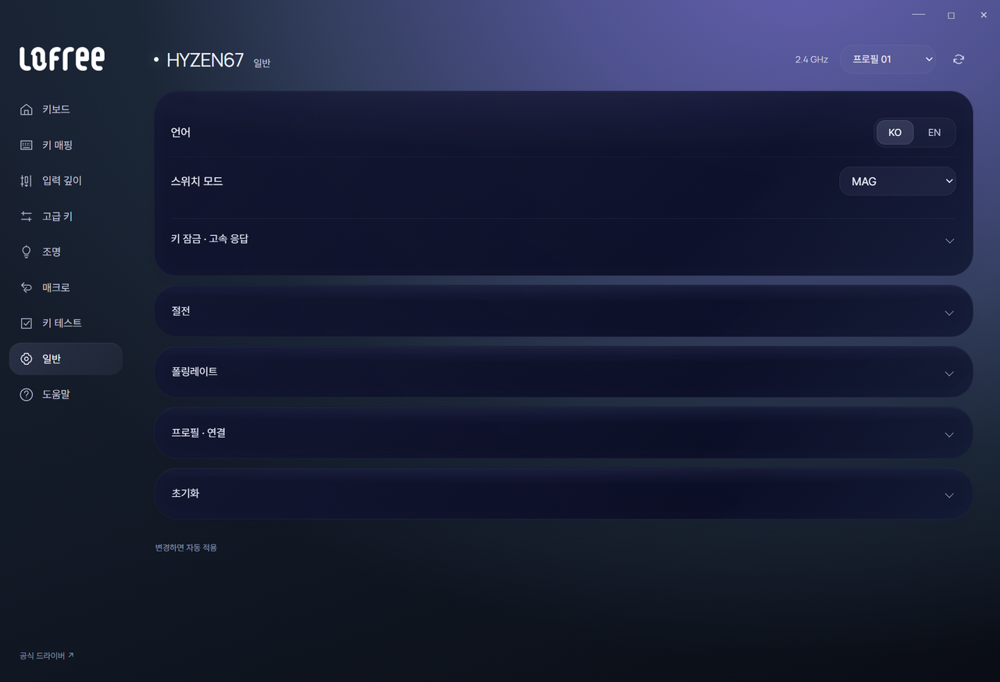

# Lofree HUB 사용 안내

## 다운로드와 실행

[Releases](https://github.com/iismn/PR-LofreeHyzenHub/releases)에서 `LofreeHUB.exe`를 내려받아 실행하세요. Windows 10/11 x64, .NET Framework 4.8과 Microsoft Edge WebView2 Runtime을 사용합니다. 관리자 권한이나 별도 HID 드라이버는 필요하지 않습니다.

USB 케이블 또는 2.4GHz 수신기를 연결하고 **연결**을 누르면 저장된 장치 값을 읽고 설정 화면으로 전환합니다. 최초 연결은 수동입니다. 연결 후에는 USB·수신기 변경을 확인하며 USB를 우선 연결합니다. 모든 장치를 빼면 시작 화면으로 돌아갑니다.

## 자동 적용

별도의 저장 버튼 없이 설정을 바꾸면 키보드에 적용합니다. 연속 조작은 묶어서 전송하고 마지막 값을 다시 읽어 확인합니다. 키·레이어·프로필·화면을 바꾸거나 창을 닫기 전에 남은 변경을 먼저 처리합니다.

하단에 **적용 대기 / 적용 중 / 적용됨**을 표시합니다. 전송이 실패하면 **다시 적용**을 누르세요. 새로고침은 대기 중인 변경을 버리고 장치의 현재 값을 다시 읽습니다. 숫자 입력 중 공란이나 범위를 벗어난 값은 전송하지 않습니다.

공식 웹 드라이버와 동시에 연결하지 마세요. 응답이 없으면 키보드를 깨우고 다른 드라이버 연결을 해제한 뒤 다시 연결하세요.

## 언어 선택

**일반 → 언어**에서 **KO / EN**을 선택합니다. 영어에서는 **General → Language**입니다. 메뉴·키 목록·도움말·상태 및 앱 오류 메시지가 함께 바뀌며, 재실행 후에도 선택한 언어를 유지합니다.

언어는 PC의 앱 설정에만 저장합니다. 언어 변경으로 키보드 값을 전송하거나 적용 대기 값을 강제로 저장하지 않습니다. 조절 중인 입력 값과 접힌 항목 상태도 유지합니다.

## 키 매핑과 프로필

상단에서 7개 프로필을 전환합니다. 키 매핑에서 사진 위 키를 선택한 뒤 아래 팔레트에서 동작을 고르세요. Ctrl을 누르며 여러 키를 선택할 수 있고 WASD·전체 선택도 지원합니다. Fn과 고정 키는 변경할 수 없습니다.

기본 레이어는 현재 프로필에 저장합니다. Windows Fn / Fn+Shift, macOS Fn / Fn+Shift의 네 레이어는 프로필 전체에서 공유합니다.

## 입력 깊이와 고급 키

MAG 모드에서는 입력 깊이, 누름·해제 Rapid Trigger, 위·아래 데드존을 조절합니다. 눈금을 드래그하거나 휠·방향키를 사용하세요. 지시기는 고정되고 눈금만 움직입니다. 놓으면 설정 단위에 안착합니다.

고급 키는 MT·TGL·DKS·RS·SOCD·HT를 지원합니다. 시작 키 하나를 선택하고 종류와 값을 조절하세요. 두 키를 연결하는 기능은 서로 다른 키를 지정해야 합니다. **일반 키로 복원**은 고급 키를 해제하고 원래 매핑으로 돌립니다.

## 조명

키보드 백라이트, 라이트 바, 수신기를 각각 선택합니다. 효과·밝기·색상과 지원되는 세부 옵션을 변경하세요. 효과와 세부 설정은 기본적으로 접혀 있습니다. 블록에 마우스를 올리면 도트·눈금에 빛이 켜집니다.

## 매크로와 키 테스트

매크로 슬롯 M1~M28에서 **녹화 시작**을 누르고 이 창에서 키를 입력하세요. 녹화를 중지하면 자동 적용합니다. 실행 방식·반복 횟수를 바꾸어도 자동 적용합니다. 키 매핑의 매크로 항목에서 해당 슬롯을 지정하면 키보드에서 재생할 수 있습니다.

창을 벗어나거나 녹화 영역 바깥을 누르면 녹화를 중지합니다. 키 테스트와 녹화는 Windows가 이 창에 전달한 입력을 사용하므로 Fn이나 운영체제가 가로채는 단축키는 나타나지 않을 수 있습니다. 표시하는 시간 간격은 실제 키보드 지연·폴링레이트 측정값이 아닙니다.

## 일반 설정과 USB 전용 항목

MAG/MEC 전환, 키 잠금, Lightspeed, 절전 시간과 현재 연결 방식의 폴링레이트를 설정합니다. 폴링레이트를 바꾸면 장치가 잠시 재연결됩니다. 실패하면 시작 화면에서 다시 연결하세요.

무선에서는 유선 폴링레이트·보정·펌웨어 업데이트 항목을 숨깁니다. USB 연결이 확인되면 해당 항목을 표시합니다. 보정 메뉴는 MAG 모드에서만 표시합니다.

**보정·펌웨어 업데이트·공장 초기화는 공식 도구를 엽니다.** 이 기능의 쓰기·보정 알고리즘은 앱 안에 구현하지 않았습니다. 공식 도구를 열기 전에 대기 작업을 처리하고 HID 연결을 해제합니다. Bluetooth 설정은 지원하지 않습니다.

## 백업

일반 → 프로필·연결에서 기본 프로필 JSON을 내보내거나 불러옵니다. 현재 프로필의 기본 키 매핑과 기능 설정을 포함합니다. Fn 레이어·입력 깊이·고급 키 내부 파라미터·매크로 본문은 포함되지 않으므로 전체 복원용 백업으로 사용하지 마세요.

## 시작 메뉴에 고정

1. Releases의 Windows ZIP을 풀고 `Install.ps1`을 PowerShell로 실행합니다.
2. 사용자 폴더 `%LOCALAPPDATA%\Programs\LofreeHUB`에 설치되고 시작 메뉴에 **Lofree HUB**가 등록됩니다.
3. 시작 메뉴에서 검색한 앱을 우클릭해 **시작에 고정**을 선택하세요.

자동 실행 등록은 하지 않습니다. 업데이트할 때는 앱을 닫고 같은 폴더의 EXE를 교체하거나 새 ZIP의 설치 스크립트를 실행하세요. 바로가기와 프로세스는 같은 `Lofree.HUB` ID를 사용합니다.

## 로컬 데이터

화면과 설정 통신은 로컬에서 처리합니다. 키 테스트 기록은 메모리에만 보관합니다. WebView2 데이터는 이전 버전과 같은 `%LOCALAPPDATA%\HyzenControl`에 저장하며, 언어 선택은 그 폴더의 `preferences.json`에 저장합니다. 공식 도구 열기 이외에는 실행 중 인터넷 연결을 요구하지 않습니다.

실물 검증 범위와 USB·고급 기능 관련 제한은 [검증 기록](validation.md), 빌드는 [기술 안내](technical-guide.md), 자산 출처는 [REFERENCE.md](../REFERENCE.md)를 참고하세요.
